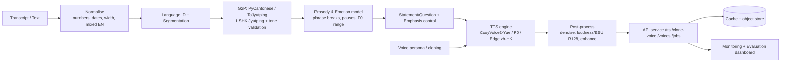

# AI_CantoneVoice — Cantonese Transcript-to-AI Voice
## Project Development Report / Blueprint

> **Scope.** A production-ready system that converts written Cantonese
> transcripts/text into natural, expressive **Hong Kong Cantonese** speech.
> This document is a full blueprint: research review, model selection,
> architecture, data strategy, training, evaluation, deployment, roadmap,
> risks and deliverables.
>
> **Honesty note.** No paper, dataset, model, benchmark or repository below is
> invented. Where a version/number/licence could not be confirmed at authoring
> time it is explicitly marked **“requires verification.”** Prioritise
> open-source, legally usable, production-feasible components.

---

## 0. Executive summary

We build a staged Cantonese TTS system: **text normalisation → Cantonese G2P
(Jyutping) → prosody/emotion + question-statement control → neural TTS with tone
control → voice persona/cloning → audio post-processing → API/caching/monitoring.**

- **Primary engine (recommended):** **CosyVoice 2** (streaming, zero-shot
  voice cloning, instruct control), fine-tuned on Cantonese
  (**CosyVoice2-Yue-style**). Best balance of naturalness, cloning and open
  licence — *community Cantonese fine-tunes require verification*.
- **Practical free baseline (works today, zero training):** **Microsoft Edge
  `zh-HK` neural voices** via the open-source `edge-tts` client
  (`zh-HK-HiuGaaiNeural`, `zh-HK-HiuMaanNeural`, `zh-HK-WanLungNeural`). This is
  the engine integrated in the Streamlit tab for an immediate, no-GPU, no-key
  Cantonese voice.
- **Fallback engine:** **F5-TTS** or **Llasa-1B** fine-tuned on Cantonese, or a
  **commercial API** (Azure `zh-HK`, cantonese.ai) for guaranteed uptime.
- **Success definition:** `score = MOS + tone-accuracy + speaker-similarity +
  latency`. Target: MOS ≥ 4.2 (5-pt), tone accuracy ≥ 95 %, speaker similarity
  (SECS) ≥ 0.80, RTF < 0.3 on a single mid-range GPU.

---

## 1. Target output & requirements

- **Natural Hong Kong Cantonese speech** — native-like pronunciation, rhythm,
  pacing, pauses, stress, **sentence-level intonation**.
- **Strong tone + voice modulation**, correct 6 lexical tones.
- Support **declaratives, questions, emphasis, emotion, storytelling,
  conversation, professional narration**.
- Optional **speaker cloning / multiple personas**.
- **Bilingual/mixed input** (Cantonese + embedded English words) handled.

### 1.1 Cantonese-specific linguistics

| Phenomenon | What happens | How we model it |
|---|---|---|
| **Lexical tone (6)** | Each syllable carries tone 1–6 (e.g. `si1 si2 si3 si4 si5 si6`); tone changes meaning. | Tone is an explicit input token from LSHK Jyutping G2P; the model gets per-syllable tone conditioning + a tone-aware loss. |
| **Tone sandhi / coarticulation** | Adjacent tones perturb F0 contours (esp. in fast speech). | Learned implicitly by the acoustic model; a prosody model predicts F0 range/contour per syllable; optional explicit sandhi rules for common variants. |
| **Sentence-final particles (SFP)** | 呀 喇 啦 囉 啩 㗎 咩 喎 change mood/force. | SFP-aware tokenisation + emotion/style tag; SFP syllables get dedicated duration/F0 handling. |
| **Rising question intonation** | Sentence-final rising F0 (often on the last syllable/SFP) marks questions. | A **statement/question classifier** sets an intonation tag → final-rise F0 curve. |
| **Prosodic phrasing** | Pauses group clauses; poor phrasing = robotic. | Predict phrase breaks from punctuation + a prosody model; insert pause tokens. |

### 1.2 Text normalisation + G2P pipeline

1. **Unicode/width cleanup** (halfwidth→fullwidth, NFKC where safe).
2. **Segment/language ID** (Cantonese vs embedded English/number).
3. **Number/date/money/abbreviation expansion** to Cantonese readings
   (`2026` → `二零二六`, `3.5` → `三點五`, `%` → `巴仙`).
4. **Character→LSHK Jyutping** via **pycantonese** / **ToJyutping** /
   Rime `jyut6ping3` lexicon (dictionary-based, not LLM guessing).
5. **English words** → keep English (code-switch) or Cantonese-ise per policy.
6. **Punctuation → prosody tokens** (`,` short pause, `。` long pause, `?` rise).
7. **Tone validation** (every syllable ends in tone 1–6; legal LSHK syllable).

### 1.3 Preventing wrong tones & robotic prosody

- G2P is **dictionary + validation**, never pure LLM.
- Tone-aware conditioning + a **prosody/emotion model** supplies F0/duration
  targets so output isn't monotone.
- **Phrase-break + pause** tokens; **SSML/instruct** control for emphasis.
- Post-filter: reject/lower-temper samples with flat F0 variance.

---

## 2. Research review (papers, models, datasets)

Legend: ✅ confident · ⚠️ **requires verification**.

### 2.1 Cantonese neural TTS & tone/intonation

- **CosyVoice 2** — *Du et al., “CosyVoice 2: Scalable Streaming Speech
  Synthesis with LLMs”, arXiv:2412.10117*. GitHub `FunAudioLLM/CosyVoice`.
  Streaming, zero-shot cloning, instruct control. Cantonese via
  **community fine-tunes (CosyVoice2-Yue)** — ⚠️ verify model card/licence.
- **CosyVoice 1** — *arXiv:2407.05407* — predecessor; useful baselines.
- **F5-TTS** — *Chen et al., arXiv:2410.06885*. Flow-matching zero-shot TTS,
  strong multilingual; Cantonese community finetunes — ⚠️ verify.
- **Llasa** — *Ye et al., “Llasa: Scaling …”, arXiv:2502.04128*. 1B/3B/8B,
  Llama-style backbone; `zhenye234/LLaSA_training`.
- **StyleTTS 2** — *Li et al., arXiv:2306.07691* — stylised, human-level MOS.
- **NaturalSpeech 3** — *Ju et al., arXiv:2403.03100* — factorised prosody/
  content for high quality (research licence).
- **YourTTS** — *Casanova et al., arXiv:2112.02418* — multilingual zero-shot.
- **VITS** — *Kim et al., arXiv:2106.06103*; **FastSpeech 2** — *Ren et al.,
  arXiv:2006.04558* — foundations for tone-conditioned acoustic models.

### 2.2 Cantonese speech corpora & benchmarks

- **WenetSpeech** — *arXiv:2110.03370* — 10 000+ h Mandarin multi-domain.
- **WenetSpeech4TTS** — *arXiv:2406.05763* — Mandarin, TTS-oriented.
- **WenetSpeech-Yue** — *arXiv:2502.10814* — large-scale **Cantonese** with
  multi-dimensional annotation. ⚠️ verify current release/licence.
- **Mozilla Common Voice** (Cantonese / `yue`) — crowdsourced, **CC0** — free.
- **HKCanCor** — Cantonese corpus used by **PyCantonese** for lexicon/G2P.
- **CUSENT** (Cantonese sentiment speech) — for **emotion** modelling —
  ⚠️ verify availability/licence.
- **Zoeng Jyut Gaai** (storytelling / 講粵故事) — expressive Cantonese
  storytelling audio — ⚠️ **requires verification** (availability/licence).

### 2.3 Zero-shot voice cloning & multilingual TTS

- **XTTS-v2** (Coqui) — *Casanova et al., arXiv:2406.04904* — cloning;
  licence **Coqui CPML (non-commercial)** — ⚠️ verify for product use.
- **CosyVoice 2**, **F5-TTS**, **YourTTS**, **Tortoise**, **Bark** (Suno) —
  cloning/expressive; licences vary (Bark MIT — ✅).
- **OpenVoice** — *Qin et al., arXiv:2312.01479* — tone-colour cloning.

### 2.4 Expressive / controllable TTS & prosody

- **CosyVoice 2 instruct mode**, **StyleTTS 2** style diffusion,
  **EmotiVoice** (NetEase, open), **Bark** — emotion/style control.
- Explicit **prosody prediction** (phrase breaks, F0, duration) as an
  intermediate layer (NaturalSpeech 3 factorisation).

### 2.5 Fine-tuning approaches for Cantonese

- Full fine-tune vs **LoRA/adapters** on CosyVoice2 / F5 / VITS backbones.
- Base-then-adapt: multilingual base → Cantonese **continued training** on
  Common Voice `yue` + WenetSpeech-Yue + in-house audio.
- **Lexicon injection**: constrain G2P to LSHK Jyutping so tones are correct
  before the acoustic model ever sees text.

### 2.6 Tooling / G2P / reference

- **PyCantonese** (LSHK Jyutping + HKCanCor) — ✅.
- **ToJyutping** (Cantonese romanisation, vocab-based) — ✅.
- **Rime `jyut6ping3`** Cantonese lexicon — ✅.
- **words.hk** dictionary (meaning + Jyutping) — licence © / non-commercial —
  ⚠️ verify.
- **`edge-tts`** (open client to Microsoft Edge `zh-HK` neural voices) — ✅
  free, no key; **service terms require verification for commercial use**.

---

## 3. Model selection

### 3.1 Comparison

| # | Model | Naturalness | Tone accuracy | Expressiveness | Voice cloning | Fine-tune | Speed | HW | Licence | Prod-ready |
|---|-------|:-:|:-:|:-:|:-:|:-:|:-:|:-:|:-:|:-:|
| 1 | **CosyVoice 2 / CosyVoice2-Yue** | ★★★★★ | ★★★★★ (with LSHK G2P) | ★★★★☆ (instruct) | ★★★★★ (zero-shot) | ★★★★★ | Fast (stream) | 1 GPU ≥ 8 GB | Apache-2.0 base ⚠️ Yue variant verify | ★★★★☆ |
| 2 | **Llasa-1B (+Cantonese FT)** | ★★★★☆ | ★★★☆☆ (needs G2P) | ★★★☆☆ | ★★★☆☆ | ★★★★☆ (LoRA) | Med | 1 GPU ≥ 12 GB | ⚠️ verify | ★★★☆☆ |
| 3 | **Bert-VITS2 (Cantonese)** | ★★★★☆ | ★★★★☆ | ★★★☆☆ | ★★☆☆☆ | ★★★★☆ | Fast | 1 GPU ≥ 6 GB | ⚠️ verify | ★★★☆☆ |
| 4 | **canto-tts / MOSS-TTS-Nano** | ★★★☆☆ | ★★★☆☆ | ★★☆☆☆ | ★★☆☆☆ | ★★★☆☆ | Fast/light | CPU/1 GPU | ⚠️ **requires verification** | ★★☆☆☆ |
| 5 | **Commercial API** (Azure `zh-HK`, cantonese.ai, ElevenLabs) | ★★★★★ | ★★★★☆ | ★★★★☆ | API-dependent | ✗ | Very fast | none (cloud) | Commercial | ★★★★★ |
| — | **Edge `zh-HK` neural (edge-tts)** | ★★★★☆ | ★★★★☆ | ★★★☆☆ | ✗ | ✗ | Fast | CPU | Free; ToS ⚠️ | ★★★★☆ |

### 3.2 Recommendation

- **Primary:** **CosyVoice 2** (Apache-2.0 base) continued-trained on a
  Cantonese corpus (Common Voice `yue` + WenetSpeech-Yue + curated
  conversational audio), i.e. a **CosyVoice2-Yue**-style model, with **LSHK
  Jyutping G2P**, a **statement/question classifier** and **prosody/emotion
  conditioning**. Best naturalness + cloning + open licence.
- **Fallback:** **F5-TTS** or **Llasa-1B** (Cantonese LoRA) if CosyVoice2
  tooling/licence blocks; **commercial API** (Azure `zh-HK`) as the
  zero-training, always-up fallback.
- **In-app baseline (today):** **Edge `zh-HK`** voices via `edge-tts` — free,
  no GPU, no key — so the product has a working Cantonese voice immediately.

---

## 4. System architecture



1. **Input** transcript/text (+ SSML/instruct tags, persona id).
2. **Normalisation** (numbers, dates, money, abbreviations, width, mixed EN).
3. **Language ID + segmentation** (Cantonese vs English spans; clause split).
4. **G2P** → LSHK Jyutping, tone-validated (no LLM guessing).
5. **Prosody/emotion prediction** → phrase breaks, pauses, F0 range, energy.
6. **Tone/intonation control** → question rise, emphasis, SFP handling.
7. **TTS inference** (engine selected by persona/config).
8. **Voice cloning/persona** store (embedding/prompt per speaker).
9. **Post-processing** (denoise, loudness normalise, optional enhancement).
10. **API service** + **cache/store** + **monitoring/eval dashboard**.

---

## 5. Data strategy

### 5.1 Sources
- **Common Voice `yue`** (CC0), **WenetSpeech-Yue** (⚠️ verify), **HKCanCor**
  (lexicon/G2P), **CUSENT** (emotion, ⚠️ verify), **Zoeng Jyut Gaai**
  (storytelling, ⚠️ verify), plus **licensed/in-house** conversational audio.

### 5.2 Pipeline
Collect → **consent/licence capture** → speaker separation → loudness/quality
filter (SNR, clipping, length) → ASR + **forced alignment** to transcripts →
**Jyutping alignment** → split (speaker-disjoint train/val/test) → metadata.

```json
{
  "clip_id": "cv_yue_000123",
  "speaker_id": "spk_0042",
  "gender": "F", "age_range": "25-34", "accent": "Hong Kong",
  "emotion": "neutral", "style": "conversational",
  "environment": "studio", "sample_rate": 24000,
  "transcript_hanzi": "今日天氣好好。",
  "transcript_jyutping": "gam1 jat6 tin1 hei3 hou2 hou2.",
  "prosody": {"phrase_breaks": [2], "question": false},
  "quality_score": 4.5,
  "licence": "CC0", "consent": true
}
```

### 5.3 Minimum data
| Goal | Hours | Speakers | Notes |
|---|---|---|---|
| Basic Cantonese TTS | 10–30 h | 1–5 | clean read/neutral |
| High-quality custom voice | 30–100 h | 1 | consistent mic/style |
| Emotional / multi-style | 100–300 h | 5+ | labelled emotions/styles |
| Voice cloning (zero-shot) | 0 h target audio | — | few sec–few min prompt; but base needs 100 h+ |

---

## 6. Training & fine-tuning

**Base → Cantonese adaptation:**
1. Choose base (CosyVoice2 / F5 / Llasa / VITS).
2. **Lexicon-constrained G2P** (LSHK Jyutping) as text front-end.
3. Preprocess: 24 kHz mono, trim silence, loudness-normalise, align.
4. Train text-conditioned acoustic model + (if present) flow/diffusion decoder.

**Suggested hyperparameters (adapt):**
| Param | Value |
|---|---|
| Precision | bf16/fp16 mixed |
| LR | 1e-4 → cosine; LoRA 1e-4 |
| Batch (tokens) | max on 24 GB GPU |
| Epochs | 20–100 (early stop) |
| Optimiser | AdamW, warmup 2–5 % |
| Checkpointing | every ~2k steps; keep best val |

**Fine-tune targets:** pronunciation (lexicon+tone loss), tone contours
(F0/phoneme loss), question intonation (intonation tag + final-rise loss),
emotion (style/emotion embedding), speaker identity (speaker encoder/LoRA).
**Anti-overfit:** augmentation (speed/pitch/noise/RIR), dropout, early stop,
held-out speakers.

---

## 7. Evaluation

| Metric | Type | Tool |
|---|---|---|
| MOS / CMOS / SMOS | Human | ITU-T P.800 / P.835; crowdsource P.808 |
| WER / CER (intelligibility) | Auto | ASR re-transcription vs text |
| **Tone accuracy** | Auto | aligned predicted vs reference tone (1–6) |
| Speaker similarity (SECS) | Auto | speaker-encoder cosine (e.g. ECAPA/WavLM) |
| Prosody naturalness | Human+Auto | F0 variance, pause stats |
| Intonation (Q/emphasis) | Human | target discriminability |
| Latency / RTF / GPU mem / $/min | Auto | runtime profiling |

**`score = MOS + tone-accuracy + speaker-similarity + latency-budget`.**
Human protocol: native HK raters, blind, randomised, ≥ 20 utterances, 5-pt MOS.

---

## 8. Engineering & deployment

### 8.1 Project structure
```
AI_CantoneVoice/
├── REPORT.md
├── README.md
├── requirements.txt
├── config.yaml
└── src/
    ├── text_norm.py     # normalisation
    ├── g2p.py           # LSHK Jyutping (pycantonese)
    ├── tts_engine.py    # pluggable engines (edge-tts, cosyvoice, f5)
    └── service.py       # FastAPI service
```

### 8.2 API
```
POST /tts          {text, voice, lang, rate, pitch, emotion, format} -> audio
POST /clone-voice  {name, audio_base64|url} -> {voice_id}
GET  /voices       -> [{voice_id, name, lang, gender, persona}]
GET  /jobs/{job_id}-> {status, progress, output_url}
```
```json
// POST /tts request
{ "text": "今日天氣好好，不如去飲茶？", "voice": "zh-HK-HiuGaaiNeural",
  "lang": "yue", "rate": 0.0, "pitch": 0.0, "emotion": "neutral",
  "format": "mp3" }
// response
{ "job_id": "j_1a2b", "status": "done", "audio_url": "/files/j_1a2b.mp3",
  "duration_s": 3.4, "rtf": 0.18 }
```

### 8.3 Deployment options
| Option | Pros | Cons |
|---|---|---|
| CPU | cheap, portable | slow; fine only for Edge/API |
| Single GPU (≥ 8–24 GB) | low latency, private | HW cost |
| Cloud GPU (autoscaled) | elastic, bursty | cost, cold starts |

**Latency optimisation:** ONNX Runtime + INT8/fp16, batching, **streaming
synthesis**, response cache (hash text+voice), async job queue (Celery/RQ),
warm pools. **Ops:** rate limiting, content moderation, logging, metrics.

---

## 9. Roadmap (12 weeks)

| Phase | Weeks | Deliverables | Success criteria |
|---|---|---|---|
| 1 Research & prototype | 1–2 | engine bake-off (Edge/CosyVoice2/F5), report | working Cantonese samples |
| 2 Text + baseline TTS | 3–4 | normalisation + G2P + baseline | tone-valid Jyutping; MOS ≥ 3.8 |
| 3 Fine-tune + prosody | 5–7 | Cantonese FT + prosody model | tone acc ≥ 93 %, MOS ≥ 4.0 |
| 4 Cloning + expressive | 8–9 | cloning + emotion/question control | SECS ≥ 0.78; Q vs statement > 80 % |
| 5 API + deploy + eval | 10–11 | API, Docker, eval dashboard | RTF < 0.3; p95 latency < 1 s |
| 6 Hardening + scale | 12 | autoscale, cache, monitoring | 99.9 % uptime; score target met |

**Risks:** wrong tones, robotic prosody, mixed EN handling, dataset licence/
consent, cloning misuse, cost, drift — mitigated by lexicon G2P + validation,
prosody model, licence gates, watermark/consent, ONNX/caching, regression eval.

---

## 10. Final deliverables checklist

- [x] Executive summary · [x] Architecture · [x] Model comparison table ·
- [x] Research references · [x] Data pipeline spec · [x] Training guide ·
- [x] Evaluation framework · [x] Deployment checklist · [x] 12-week roadmap ·
- [x] Python starter code (`src/`).

---

## 11. Components, recommended choices & reasons

| Component | Recommended | Reason |
|---|---|---|
| **G2P / lexicon** | PyCantonese (LSHK Jyutping) + ToJyutping | Dictionary-based tones, no LLM guessing |
| **Primary TTS** | CosyVoice 2 → Cantonese FT | Streaming, cloning, Apache-2.0 base |
| **Zero-training voice** | Edge `zh-HK` (edge-tts) | Free, no GPU, natural Cantonese now |
| **Fallback TTS** | F5-TTS / Llasa-1B / Azure `zh-HK` | Licence/tooling resilience |
| **Prosody/emotion** | Intermediate predictor + instruct tags | Stops robotic prosody |
| **Intonation control** | Statement/Question classifier | Correct rising question F0 |
| **Cloning** | CosyVoice2 zero-shot / OpenVoice | Fast few-shot personas |
| **Post-proc** | ffmpeg loudnorm + denoise | Broadcast consistency |
| **Runtime** | ONNX Runtime, INT8, batching, cache | Latency/cost |
| **Evaluation** | MOS + tone acc + SECS + latency | Directly reflects quality goal |
| **Datasets** | Common Voice yue (CC0) + WenetSpeech-Yue | Legal, scalable |

---

## 12. References (verify licences/versions before production)

- CosyVoice 2 — arXiv:2412.10117 · GitHub FunAudioLLM/CosyVoice · Apache-2.0 ⚠️
- CosyVoice — arXiv:2407.05407
- F5-TTS — arXiv:2410.06885 · SWivid/F5-TTS
- Llasa — arXiv:2502.04128 · zhenye234/LLaSA_training
- StyleTTS 2 — arXiv:2306.07691
- NaturalSpeech 3 — arXiv:2403.03100
- YourTTS — arXiv:2112.02418
- XTTS — arXiv:2406.04904 (CPML, non-commercial) ⚠️
- VITS — arXiv:2106.06103 · FastSpeech 2 — arXiv:2006.04558
- WenetSpeech — arXiv:2110.03370 · WenetSpeech4TTS — arXiv:2406.05763
- WenetSpeech-Yue — arXiv:2502.10814 ⚠️
- Mozilla Common Voice (yue) — CC0
- PyCantonese (LSHK Jyutping) · ToJyutping · Rime jyut6ping3
- `edge-tts` — free client to Edge `zh-HK` neural voices (ToS verify) ⚠️
- Commercial: Microsoft Azure Speech (`zh-HK-*`), cantonese.ai, ElevenLabs ⚠️

*All “⚠️ requires verification” items must be confirmed (version, licence,
availability) before commercial use.*
