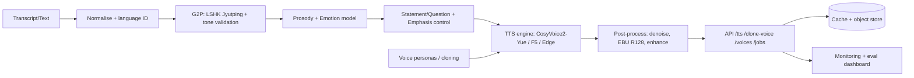

# CantoneVoice Production — Cantonese Transcript-to-AI Voice
## Production-Grade Project Development Report

> **Goal.** Convert written Cantonese text/transcripts into **highly natural,
> expressive Hong Kong Cantonese speech** that sounds like a native speaker —
> production-ready: API, deployment, scaling, monitoring, evaluation.
>
> **Honesty note.** No paper/dataset/model/repo/benchmark here is invented.
> Anything whose version/licence/availability could not be confirmed is marked
> **“requires verification.”** Prefer open-source, legally usable, feasible parts.

---

## 0. Executive summary

A staged system: **text normalisation → Cantonese G2P (LSHK Jyutping) →
prosody + emotion + statement/question control → neural TTS with tone control →
voice persona/cloning → audio post-processing → API + cache + monitoring + eval.**

- **Primary engine:** **CosyVoice 2** (streaming, zero-shot cloning, instruct),
  continued-trained on Cantonese (**CosyVoice2-Yue-style**). Apache-2.0 base;
  community Yue variant ⚠️ verify.
- **Zero-training baseline (ships working):** **Edge `zh-HK` neural voices**
  via `edge-tts` (`zh-HK-HiuGaaiNeural`, `zh-HK-HiuMaanNeural`,
  `zh-HK-WanLungNeural`) — free, no GPU/key.
- **Fallback:** F5-TTS / Llasa-1B (Cantonese LoRA) / commercial API (Azure `zh-HK`).
- **Quality target:** `score = MOS + tone-accuracy + speaker-similarity + latency`;
  MOS ≥ 4.2, tone accuracy ≥ 95 %, SECS ≥ 0.80, RTF < 0.3 (single mid GPU).

---

## 1. Target output & requirements

- Natural HK Cantonese: pronunciation, rhythm, pacing, pauses, stress,
  **sentence-level intonation**, strong **tone + voice modulation**.
- Styles: declarative, question, emphasis, emotional, storytelling,
  conversational, professional narration.
- Optional **speaker cloning / multiple personas**.

### 1.1 Cantonese linguistics (handling)

| Phenomenon | Handling |
|---|---|
| **6 lexical tones** | Explicit per-syllable tone from LSHK Jyutping G2P; tone-conditioned model + tone-aware loss. |
| **Tone sandhi / coarticulation** | Learned by the acoustic model; prosody model predicts F0 contour/range per syllable. |
| **Sentence-final particles** (呀 喇 啦 囉 啩 㗎 咩 喎) | SFP-aware tokenisation + style tag; dedicated duration/F0 treatment. |
| **Rising question intonation** | Statement/Question classifier → final-rise F0 target. |
| **Prosodic phrasing** | Phrase-break + pause tokens from punctuation + prosody model. |

### 1.2 Text normalisation + G2P pipeline

1. Unicode/width cleanup (half→full width, NFKC where safe).
2. Language ID + segmentation (Cantonese vs embedded English/numbers).
3. Number/date/money/abbrev expansion to Cantonese readings.
4. Character→**LSHK Jyutping** via PyCantonese / ToJyutping / Rime `jyut6ping3`
   (dictionary-based).
5. English words: keep (code-switch) or Cantonese-ise per policy.
6. Punctuation → prosody tokens; 7. Tone validation (tone 1–6, legal syllable).

### 1.3 Preventing wrong tones / robotic prosody
- G2P is **dictionary + validator**, never LLM.
- Prosody/emotion predictor → F0/duration targets (not monotone).
- Phrase-break/pause tokens + SSML/instruct emphasis.
- Post-filter low-F0-variance (flat) samples.

---

## 2. Research review

Legend ✅ confident · ⚠️ requires verification.

**Cantonese neural TTS / tone & intonation**
- **CosyVoice 2** — *arXiv:2412.10117*, GitHub `FunAudioLLM/CosyVoice` — streaming,
  zero-shot cloning, instruct; Cantonese via community Yue fine-tunes ⚠️.
- **CosyVoice** — *arXiv:2407.05407*.
- **F5-TTS** — *arXiv:2410.06885*, `SWivid/F5-TTS` — flow-matching zero-shot.
- **Llasa** — *arXiv:2502.04128*, `zhenye234/LLaSA_training` — 1B/3B/8B.
- **StyleTTS 2** — *arXiv:2306.07691*; **NaturalSpeech 3** — *arXiv:2403.03100*.
- **VITS** — *arXiv:2106.06103*; **FastSpeech 2** — *arXiv:2006.04558*.

**Cantonese corpora / benchmarks**
- **WenetSpeech** — *arXiv:2110.03370*; **WenetSpeech4TTS** — *arXiv:2406.05763*.
- **WenetSpeech-Yue** — *arXiv:2502.10814* ⚠️ verify.
- **Mozilla Common Voice (`yue`)** — CC0 ✅.
- **HKCanCor** (PyCantonese lexicon/G2P).
- **CUSENT** (Cantonese emotion) ⚠️ verify.
- **Zoeng Jyut Gaai** (storytelling) ⚠️ **requires verification**.

**Zero-shot cloning / multilingual**
- **XTTS-v2** (Coqui) — *arXiv:2406.04904*; licence **CPML (non-commercial)** ⚠️.
- **YourTTS** — *arXiv:2112.02418*; **OpenVoice** — *arXiv:2312.01479*;
  **Bark** (Suno) MIT ✅.

**Expressive / controllable & prosody** — CosyVoice 2 instruct, StyleTTS 2 style
diffusion, EmotiVoice (NetEase), NaturalSpeech 3 factorisation.

**Fine-tuning for Cantonese** — LoRA/adapters on CosyVoice2/F5/VITS; multilingual
base → Cantonese continued training (Common Voice `yue` + WenetSpeech-Yue +
in-house); **lexicon-constrained G2P** so tones are right before acoustics.

**Tooling / G2P** — **PyCantonese** ✅, **ToJyutping** ✅, Rime `jyut6ping3` ✅,
**words.hk** ⚠️ (licence), **`edge-tts`** ✅ free (ToS ⚠️ for commercial).

---

## 3. Model selection

| # | Model | Naturalness | Tone acc | Expressiveness | Cloning | Fine-tune | Speed | HW | Licence | Prod-ready |
|---|-------|:-:|:-:|:-:|:-:|:-:|:-:|:-:|:-:|:-:|
| 1 | **CosyVoice2 / CosyVoice2-Yue** | ★★★★★ | ★★★★★ | ★★★★☆ | ★★★★★ | ★★★★★ | Fast (stream) | 1 GPU ≥8 GB | Apache-2.0 base ⚠️ Yue | ★★★★☆ |
| 2 | **Llasa-1B (+Cantonese FT)** | ★★★★☆ | ★★★☆☆ | ★★★☆☆ | ★★★☆☆ | ★★★★☆ | Med | 1 GPU ≥12 GB | ⚠️ verify | ★★★☆☆ |
| 3 | **Bert-VITS2 (Cantonese)** | ★★★★☆ | ★★★★☆ | ★★★☆☆ | ★★☆☆☆ | ★★★★☆ | Fast | 1 GPU ≥6 GB | ⚠️ verify | ★★★☆☆ |
| 4 | **canto-tts / MOSS-TTS-Nano** | ★★★☆☆ | ★★★☆☆ | ★★☆☆☆ | ★★☆☆☆ | ★★★☆☆ | Fast/light | CPU/GPU | ⚠️ **verify** | ★★☆☆☆ |
| 5 | **Commercial API** (Azure `zh-HK`, cantonese.ai, ElevenLabs) | ★★★★★ | ★★★★☆ | ★★★★☆ | API-dependent | ✗ | Very fast | none | Commercial | ★★★★★ |
| — | **Edge `zh-HK` (edge-tts)** | ★★★★☆ | ★★★★☆ | ★★★☆☆ | ✗ | ✗ | Fast | CPU | Free; ToS ⚠️ | ★★★★☆ |

**Primary:** CosyVoice 2 + Cantonese continued training + LSHK G2P +
statement/question classifier + prosody/emotion conditioning.
**Fallback:** F5-TTS / Llasa-1B / Azure `zh-HK`. **Baseline:** Edge `zh-HK`.

---

## 4. System architecture



Ten stages: input → normalise → LID/segment → G2P → prosody/emotion →
tone/intonation control → TTS inference → persona/cloning → post-processing →
API + cache + monitoring.

---

## 5. Data strategy

**Sources:** Common Voice `yue` (CC0), WenetSpeech-Yue ⚠️, HKCanCor,
CUSENT ⚠️, Zoeng Jyut Gaai ⚠️, licensed/in-house conversational audio.

**Pipeline:** collect → **consent/licence** → speaker separation → quality filter
(SNR/clipping/length) → ASR + **forced alignment** → **Jyutping alignment** →
speaker-disjoint split → metadata.

```json
{"clip_id":"cv_yue_000123","speaker_id":"spk_0042","gender":"F","age_range":"25-34",
 "accent":"Hong Kong","emotion":"neutral","style":"conversational","environment":"studio",
 "sample_rate":24000,"transcript_hanzi":"今日天氣好好。",
 "transcript_jyutping":"gam1 jat6 tin1 hei3 hou2 hou2.",
 "prosody":{"phrase_breaks":[2],"question":false},"quality_score":4.5,
 "licence":"CC0","consent":true}
```

| Goal | Hours | Speakers |
|---|---|---|
| Basic Cantonese TTS | 10–30 h | 1–5 |
| High-quality custom voice | 30–100 h | 1 |
| Emotional / multi-style | 100–300 h | 5+ |
| Voice cloning (zero-shot) | prompt only | — |

---

## 6. Training & fine-tuning

1. Pick base (CosyVoice2/F5/Llasa/VITS). 2. Lexicon-constrained G2P.
3. Preprocess 24 kHz mono, trim, loudness-normalise, align.
4. Train text-conditioned acoustic model + flow/diffusion decoder.

| Param | Value |
|---|---|
| Precision | bf16/fp16 |
| LR | 1e-4 cosine (LoRA 1e-4) |
| Batch | max on 24 GB |
| Epochs | 20–100 early-stop |
| Optimiser | AdamW, warmup 2–5 % |
| Ckpt | every ~2k steps, keep best val |

Targets: pronunciation (lexicon+tone loss), tone contours (F0 loss), question
intonation (tag + rise loss), emotion (style embedding), speaker identity
(speaker-encoder/LoRA). Anti-overfit: augment (speed/pitch/noise/RIR), dropout,
early stop, held-out speakers.

---

## 7. Evaluation

| Metric | Type | Tool |
|---|---|---|
| MOS/CMOS/SMOS | Human | ITU-T P.800/P.835, crowdsource P.808 |
| WER/CER | Auto | ASR re-transcription |
| **Tone accuracy** | Auto | aligned predicted vs ref tone |
| Speaker similarity (SECS) | Auto | speaker encoder cosine |
| Prosody naturalness | H+A | F0 variance, pause stats |
| Intonation (Q/emphasis) | Human | target discriminability |
| Latency/RTF/GPU mem/$/min | Auto | profiling |

`score = MOS + tone-accuracy + speaker-similarity + latency-budget`.
Human: native HK raters, blind, randomised, ≥20 utts, 5-pt MOS.

---

## 8. Engineering & deployment

```
production_blueprint/
├── REPORT.md  README.md  requirements.txt  Dockerfile  docker-compose.yml
└── src/service.py
```

**API**
```
POST /tts          {text, voice, lang, rate, pitch, emotion, format} -> audio
POST /clone-voice  {name, audio_base64|url} -> {voice_id}
GET  /voices       -> [{voice_id, name, lang, gender, persona}]
GET  /jobs/{job_id}-> {status, progress, output_url}
```
```json
// request
{ "text":"今日天氣好好，不如去飲茶？","voice":"zh-HK-HiuGaaiNeural","lang":"yue",
  "rate":"+0%","pitch":"+0Hz","emotion":"neutral","format":"mp3" }
// response
{ "job_id":"j_1a2b","status":"done","audio_url":"/files/j_1a2b.mp3",
  "duration_s":3.4,"rtf":0.18 }
```

**Deployment** | CPU (cheap, slow; Edge/API ok) | single GPU ≥8–24 GB (low latency,
private) | cloud GPU (elastic, cold starts).
**Latency:** ONNX Runtime + INT8/fp16, batching, **streaming**, response cache,
async queue (Celery/RQ), warm pools. **Ops:** rate limiting, moderation, logs, metrics.

---

## 9. Roadmap (12 weeks)

| Phase | Wk | Deliverables | Success |
|---|---|---|---|
| 1 Research/proto | 1–2 | engine bake-off | working samples |
| 2 Text+baseline | 3–4 | norm + G2P + baseline | tone-valid; MOS ≥3.8 |
| 3 FT+prosody | 5–7 | Cantonese FT + prosody | tone ≥93 %; MOS ≥4.0 |
| 4 Clone+expressive | 8–9 | cloning + emotion/Q | SECS ≥0.78; Q vs stmt >80 % |
| 5 API+deploy+eval | 10–11 | API, Docker, dashboard | RTF<0.3; p95<1 s |
| 6 Harden+scale | 12 | autoscale, cache, monitoring | 99.9 % uptime |

---

## 10. Risks & mitigation

| Risk | Mitigation |
|---|---|
| Wrong pronunciation | lexicon G2P + tone validation + native review |
| Tone errors | tone-aware loss, tone accuracy metric, tone-balanced data |
| Robotic prosody | prosody/emotion model, phrase breaks, style tags |
| Mixed Canto-English | language ID + code-switch handling + EN lexicon |
| Dataset licence/consent | licence registry, consent, CC0/open only by default |
| Cloning misuse | consent-gated cloning, watermarking, abuse policy |
| High cost | ONNX/quant, batching, caching, autoscale to zero |
| Drift/regression | scheduled eval, golden set, versioned models |

---

## 11. Components, recommended choices & reasons

| Component | Recommended | Reason |
|---|---|---|
| G2P/lexicon | PyCantonese (LSHK) + ToJyutping | dictionary tones, no LLM guessing |
| Primary TTS | CosyVoice 2 → Cantonese FT | streaming, cloning, Apache base |
| Zero-training voice | Edge `zh-HK` (edge-tts) | free, no GPU/key, natural now |
| Fallback TTS | F5-TTS / Llasa-1B / Azure `zh-HK` | licence/tooling resilience |
| Prosody/emotion | predictor + instruct tags | stops robotic prosody |
| Intonation | statement/question classifier | correct rising question F0 |
| Cloning | CosyVoice2 zero-shot / OpenVoice | few-shot personas |
| Post-proc | ffmpeg loudnorm + denoise | broadcast consistency |
| Runtime | ONNX Runtime, INT8, cache | latency/cost |
| Evaluation | MOS + tone acc + SECS + latency | matches quality goal |
| Data | Common Voice yue (CC0) + WenetSpeech-Yue | legal, scalable |

---

## 12. Deliverables checklist

Executive summary ✅ · Architecture ✅ · Model comparison ✅ · References ✅ ·
Data pipeline spec ✅ · Training guide ✅ · Evaluation framework ✅ ·
Deployment checklist ✅ · 12-week roadmap ✅ · Python starter (`src/service.py`) ✅.

## 13. References (verify licences/versions)

CosyVoice2 arXiv:2412.10117 · CosyVoice arXiv:2407.05407 · F5-TTS arXiv:2410.06885 ·
Llasa arXiv:2502.04128 · StyleTTS2 arXiv:2306.07691 · NaturalSpeech3 arXiv:2403.03100 ·
YourTTS arXiv:2112.02418 · XTTS arXiv:2406.04904 · VITS arXiv:2106.06103 ·
FastSpeech2 arXiv:2006.04558 · WenetSpeech arXiv:2110.03370 · WenetSpeech4TTS
arXiv:2406.05763 · WenetSpeech-Yue arXiv:2502.10814 ⚠️ · Common Voice (yue) CC0 ·
PyCantonese · ToJyutping · Rime jyut6ping3 · edge-tts ⚠️ · Azure Speech (`zh-HK-*`),
cantonese.ai, ElevenLabs ⚠️.

*All ⚠️ items require verification before commercial use.*
